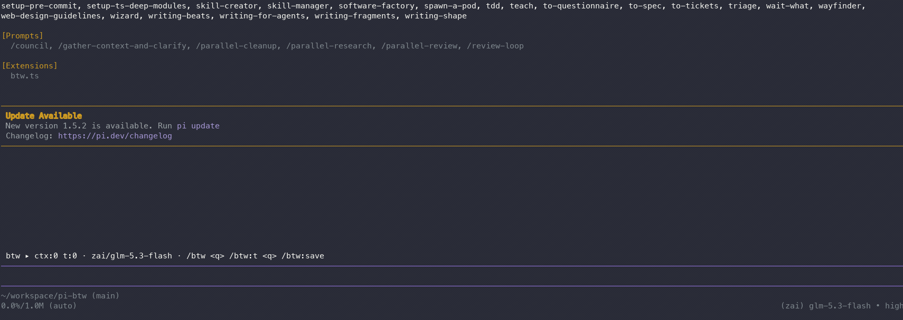

# @fookhsu/pi-btw

pi 的侧问通道：主 agent 忙着干活时，`/btw` 一句插入，答案不进主上下文。

竞品调研见 [RESEARCH.md](./RESEARCH.md)。基于调研取中道：真线程可追问（dbachelder 式体验），但无工具、单文件实现（pandi 式克制）。



## 命令

| 命令 | 作用 |
|---|---|
| `/btw <问题>` | ctx 线程：首问自动快照主会话上下文（最近 N 条消息），连续追问共享线程 |
| `/btw`（无参数） | 显示线程状态：轮数、模型、保存路径 |
| `/btw:t <问题>` | tangent 线程：不带任何主上下文，纯外脑 |
| `/btw:save [ctx\|t]` | **再次发送**：把线程喂给模型按 saveSystemPrompt 整理，追加到 savePath（默认最近活跃线程） |
| `/btw:new [all\|ctx\|t]` | 清空线程，下次 /btw 重新快照 |

每次问答完成即**自动追加**原始问答到 savePath；`/btw:save` 追加的是整理后的笔记。

## 配置 `~/.pi/agent/btw.json`

```json
{
  "model": "zai/glm-5.3-flash",        // 侧问模型，缺省跟随主会话
  "thinkingLevel": "high",             // off/minimal/low/medium/high/xhigh/max
  "systemPrompt": "...",               // 追加到侧问人设之后的额外指令
  "contextMessages": 6,                // ctx 快照取主会话最近几条消息
  "contextBudget": 12000,              // 快照字符上限（超长掐中段）
  "savePath": "~/btw-notes.md",        // 笔记文档路径，自动建父目录
  "autoSave": true,                    // 每次问答自动追加原始记录
  "saveModel": "...",                  // save 整理用模型，缺省回落到 model
  "saveThinkingLevel": "low",          // 缺省回落到 thinkingLevel
  "saveSystemPrompt": "..."            // 整理笔记的 system prompt（有中文默认值）
}
```

环境变量覆盖：`BTW_CONFIG`（配置文件路径）、`BTW_SAVE_PATH`（保存路径）。

## 行为细节

- **主线程忙碌时可随时发问**（实测 sleep 25 期间 +2.5s 插入 +4.9s 出答案）。
- **线程跨 `/reload`、跨重启存活**：每轮问答持久化为 `btw:turn` 自定义条目，加载时重建；Esc 中止的轮次不入线程。
- **主上下文不可见**：侧问答案以自定义条目存在，不进主 agent 的 LLM 上下文；侧线无工具，纯文本推理。
- ctx 线程的上下文快照在**首问时**定格，之后追问用同一线程历史；主会话有新进展想带入就 `/btw:new` 后重问。
- TUI 下流式覆盖层显示回答（Esc 中止）；print/RPC 模式无 UI 也能用。

## 开发

```
pi -e /Users/hsu/workspace/pi-btw        # 或已全局安装（链接），改完 /reload 即生效
```

无头测试（RPC 驱动）：`pi --mode rpc --no-session -e ./extensions/btw.ts`，发 `{"type":"prompt","message":"/btw ..."}` 观察 `entry_appended` 与 `extension_ui_request`。
